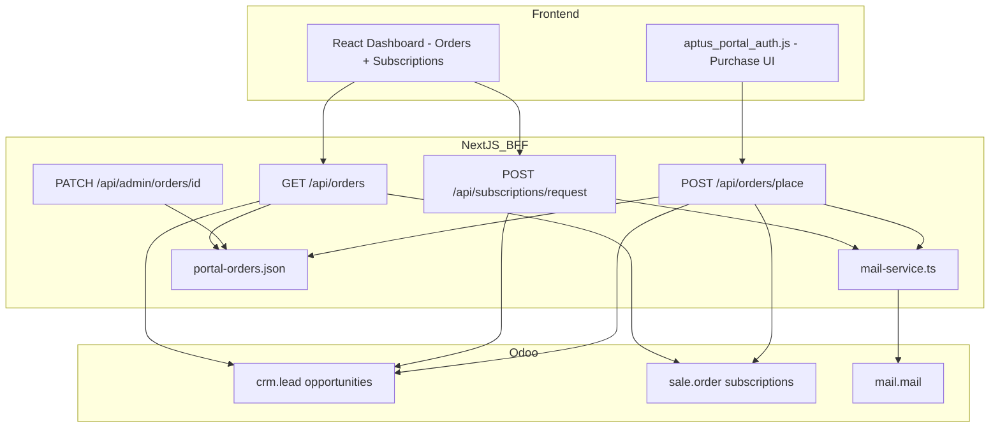

# Phase 3–8 Deliverables — Product Purchase & Subscription Module

## Phase 3 — Gap Analysis Report

| Requirement | Current State | Missing | Required Change |
|-------------|---------------|---------|-----------------|
| **Product categories (Adobe, Microsoft, Autodesk, Antivirus)** | Implemented in `public/js/aptus_portal_auth.js` with expand/collapse accordion | React-native purchase UI | Keep legacy UI; add React parity optional |
| **Single / multi product selection** | Checkboxes + quantity in legacy JS | — | — |
| **1 Year / 3 Year duration** | Legacy UI + `placeOrderSchema` | — | — |
| **Order submission → CRM + sale.order** | `POST /api/orders/place` creates Odoo opportunity + draft SO | SO sequence config in Odoo staging | Configure `sale.order.software.quotation` in Odoo |
| **Order reference number** | Generated `ORD-*`, `SO-*`, or `LEAD-*` | — | — |
| **Status = Submitted** | Persisted in `.data/portal-orders.json` | Full workflow statuses in Odoo | Admin API updates local status; Odoo maps draft/sent/sale |
| **Confirmation modal (48h message)** | Legacy JS modal | — | — |
| **Email to backend team** | **Was:** audit log only | SMTP / Odoo mail send | **Implemented:** `mail-service.ts` via SMTP or Odoo `mail.mail` |
| **Active subscriptions dashboard** | React `SubscriptionsPanel` reads Odoo `sale.order` | Expiring Soon / Cancelled | **Implemented:** extended status mapping |
| **Renew / upgrade / downgrade / cancel** | Legacy localStorage only; cancel API existed | React actions + request API | **Implemented:** `POST /api/subscriptions/request` → CRM lead + email |
| **Order list with statuses** | Local purchases in legacy JS only | Unified read API | **Implemented:** `GET /api/orders` merges local + Odoo |
| **Admin approve/reject orders** | Not present | Full admin UI | **Implemented:** `PATCH /api/admin/orders/[id]` (API; UI in Odoo CRM) |
| **Document download** | Not implemented | Odoo attachment API | Future: fetch invoice PDF from Odoo |
| **Duplicate order prevention** | None | Idempotency | **Implemented:** 5-minute window hash in `portal-orders.ts` |
| **Payment → Odoo link** | Stripe intent only | Payment reconciliation | Future Odoo accounting integration |

### Functional Gaps (remaining Odoo-side)

- Won → activate subscription automation (Odoo server action)
- Software quotation sequence for sale orders
- Invoice / document download from Odoo attachments
- Full admin UI (React page) — API foundation exists

### Technical Gaps (addressed in this delivery)

| Area | Change |
|------|--------|
| Models | `PortalOrder` type; `.data/portal-orders.json` store |
| Fields | `renewalDateIso`, extended `SubscriptionStatus` |
| Controllers / routes | `GET /api/orders`, `POST /api/subscriptions/request`, admin order routes |
| Email | `mail-service.ts` (SMTP + Odoo fallback) |
| Access rights | `admin-auth.ts` via `ADMIN_EMAILS` or JWT `admin` role |

### UI/UX Gaps (addressed)

| Issue | Fix |
|-------|-----|
| No React order list | `OrdersPanel` on dashboard + purchases |
| No subscription actions in React | Renew / upgrade / downgrade / cancel buttons on `SubscriptionCard` |
| Dual UI confusion | React panels for orders + subscriptions when `useApiAuth: true` |

---

## Phase 4 — Product Purchase Module (Implementation Summary)

### Workflow

```
Customer selects products (legacy JS)
  → Payment (optional Stripe)
  → POST /api/orders/place
      → Duplicate check (5 min)
      → CRM opportunity (Software Sales team)
      → Draft sale.order (if sequence configured)
      → Email to ORDER_NOTIFICATION_EMAIL
      → Persist PortalOrder (status: Submitted)
  → Confirmation modal (48h message)
```

### Subscription request workflow

```
Customer clicks Renew / Upgrade / Downgrade / Cancel (React card)
  → POST /api/subscriptions/request
      → CRM opportunity with request type
      → Email to backend team
      → Audit log entry
```

---

## Phase 5 — User Dashboard

| View | Location | Statuses |
|------|----------|----------|
| Orders | `/portal/dashboard`, `/portal/purchases` | Submitted, Under Review, Approved, Rejected, Completed |
| Subscriptions | `/portal/subscriptions` | Active, Expiring Soon, Expired, Cancelled |
| Renewals | `/portal/renewals` | Filter: Expiring Soon |

**Actions on subscription cards:** Renew, Request upgrade, Request downgrade, Request cancellation, View details (inline), License reveal.

---

## Phase 6 — Backend Admin Panel

| Capability | Implementation |
|------------|----------------|
| View all orders | `GET /api/admin/orders` (requires admin) |
| Approve / reject / update status | `PATCH /api/admin/orders/[id]` |
| Assign staff | `assignedStaff` field in PATCH body |
| Email on approve/reject | Automatic via `mail-service.ts` |

**Admin access:** Set `ADMIN_EMAILS=you@company.com` in `.env.local` or assign JWT role `admin`.

**Odoo admin operations** (activate, suspend, renew, extend, cancel subscriptions) remain in Odoo backend — portal creates CRM requests; staff process in Odoo Sales / Subscriptions app.

---

## Phase 7 — Validation & Edge Cases

| Case | Handling |
|------|----------|
| No product selected | `placeOrderSchema` min 1 item |
| Invalid duration | Zod enum `1year` \| `3year` |
| Duplicate submission | Idempotency key, 5-minute window |
| Subscription already expired | Shown as Expired; renew still creates CRM request |
| Renewal before/after expiry | Request API accepts any active/expired sub |
| Upgrade during active sub | Allowed via request API |
| Unauthorized access | 401 on all protected routes |
| Admin without role | 403 on `/api/admin/*` |
| No partner linked | 400 with clear message |
| Odoo unavailable | Demo mode fallback |

---

## Phase 8 — Technical Documentation

### New files

| File | Purpose |
|------|---------|
| `src/types/orders.ts` | Order types |
| `src/lib/server/mail-service.ts` | SMTP + Odoo email |
| `src/lib/server/portal-orders.ts` | Order persistence |
| `src/lib/server/admin-auth.ts` | Admin gate |
| `src/lib/server/odoo/orders.ts` | Merge Odoo + local orders |
| `src/lib/server/odoo/subscription-requests.ts` | CRM leads for sub requests |
| `src/app/api/orders/route.ts` | List orders |
| `src/app/api/subscriptions/request/route.ts` | Subscription lifecycle requests |
| `src/app/api/admin/orders/route.ts` | Admin list |
| `src/app/api/admin/orders/[id]/route.ts` | Admin status update |
| `src/hooks/useOrders.ts` | Client order fetch |
| `src/components/portal/OrdersPanel.tsx` | Order UI |

### Modified files

| File | Change |
|------|--------|
| `src/app/api/orders/place/route.ts` | Email send, persist order, duplicate guard |
| `src/lib/server/odoo/subscriptions.ts` | Expiring Soon, Cancelled, include inactive |
| `src/types/subscriptions.ts` | Extended statuses |
| `src/components/portal/SubscriptionCard.tsx` | Action buttons |
| `src/components/portal/SubscriptionsPanel.tsx` | Status filter, reload |
| `src/components/portal/PortalDashboardShell.tsx` | Orders + renewals integration |
| `src/lib/server/validation.ts` | Request + admin schemas |
| `src/lib/server/order-notification.ts` | Subscription request email template |
| `src/styles/customer-dashboard.css` | Orders + action styles |
| `.env.example` | SMTP, ADMIN_EMAILS |
| `package.json` | nodemailer dependency |

### Email templates

- Order notification: `formatOrderNotificationEmail()` in `order-notification.ts`
- Subscription request: `formatSubscriptionRequestEmail()` in same file

### Environment variables

```env
ORDER_NOTIFICATION_EMAIL=support@aptusinfotech.com
SMTP_HOST=...
SMTP_PORT=587
SMTP_FROM=portal@aptusinfotech.com
ADMIN_EMAILS=admin@aptusinfotech.com
SUBSCRIPTION_EXPIRING_DAYS=30
```

---

## Testing Checklist

### Unit test cases (manual / recommended automation)

1. `buildOrderIdempotencyKey` produces stable hash for same cart
2. `findRecentDuplicateOrder` blocks within 5 minutes
3. `mapSubscriptionStatus` returns Expiring Soon when end_date ≤ 30 days
4. `isAdminClaims` respects ADMIN_EMAILS and admin role
5. `mergeOrderStatus` prefers admin-updated status over Odoo hint

### Functional test cases

1. Place order with 2 products, 3-year duration → CRM opportunity in Software Sales team
2. Verify confirmation modal text matches spec
3. Verify email received at ORDER_NOTIFICATION_EMAIL (with SMTP configured)
4. Duplicate submit within 5 min → same reference, no duplicate CRM
5. Dashboard shows order with status Submitted
6. Admin PATCH status to Approved → audit log + email
7. Subscription card Renew → CRM lead + email
8. Renewals page shows Expiring Soon subscriptions only
9. Cancel request on active subscription → CRM lead created
10. Non-admin GET `/api/admin/orders` → 403

### User acceptance test cases

1. Customer completes purchase end-to-end and sees order in Purchases tab
2. Customer sees active subscription with correct product name and renewal date
3. Customer submits renewal request and receives confirmation message on card
4. Backend team receives email with customer name, company, products, duration, reference
5. Admin updates order to Rejected; customer sees updated status after refresh

---

## Odoo Configuration Checklist (outside repo)

1. Configure software sale order sequence
2. Ensure `end_date` populated on subscription confirm
3. Won stage automation → `subscription_state = 3_progress`
4. License field on `sale.order.line` (`ODOO_LICENSE_FIELD`)
5. Outgoing mail server in Odoo (if not using external SMTP)

---

## Architecture Diagram


