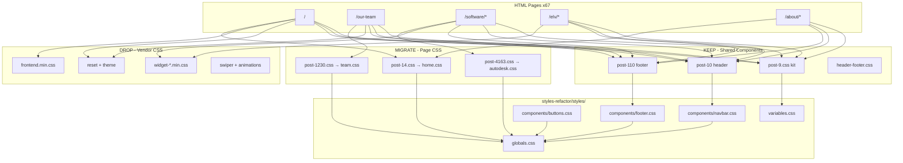

# Aptus CSS Architecture Audit & Migration Report

**Generated:** 2026-06-30  
**Scanner:** `scripts/css-architecture-audit.mjs`  
**Machine-readable outputs:** `styles-refactor/audit-report.json`, `styles-refactor/migration-manifest.json`

---

## Executive Summary

| Metric | Count |
|--------|------:|
| HTML pages scanned | **67** |
| CSS files in LIVE WEBSITE | **1,550** |
| Unique `post-*.css` page stylesheets | **71** |
| Vendor/widget CSS (drop in migration) | **25 types** |
| Shared components on every page | navbar, footer, hero, features, cards, forms, maps |
| Testimonials (subset) | 12 pages |
| CTA bands (subset) | 7 pages |

The live site is a **WordPress + Elementor 4.x** export. Each saved HTML page bundles 14–20 external CSS files plus 3–6 embedded `<style>` blocks. The Next.js codebase (`styles/`, `components/`) already mirrors ~40% of the design system via Tailwind `@theme` and `site-header.css`.

---

## 1. Full Style Inventory

### Global / Theme (every page)

| File | Role |
|------|------|
| `post-9.css` | **Elementor kit** — brand colors, typography, container widths |
| `reset.css` | Hello Elementor reset |
| `theme.css` | Hello Elementor theme |
| `header-footer.css` | Shared header/footer shell |
| `frontend.min.css` | Elementor core |
| `poppins.css` | Font faces |

### Vendor / Widget CSS (drop — replace with components)

`style.min.css`, `latest.css`, `swiper.min.css`, `e-swiper.min.css`, `widget-nav-menu.min.css`, `widget-heading.min.css`, `widget-image.min.css`, `widget-icon-list.min.css`, `widget-social-icons.min.css`, `widget-google_maps.min.css`, `widget-form.min.css`, `widget-flip-box.min.css`, `widget-testimonial-carousel.min.css`, `widget-image-carousel.min.css`, `widget-carousel-module-base.min.css`, `e-animation-shrink.min.css`, `e-animation-grow.min.css`, `e-animation-bounce-in.min.css`, `motion-fx.min.css`, `apple-webkit.min.css`, `popup.min.css`

### Shared post CSS (site chrome)

| File | Role |
|------|------|
| `post-10.css` | Header template |
| `post-110.css` | Footer template |

### Page-specific post CSS (unique per route)

Examples: `post-14.css` (home), `post-1230.css` (team), `post-4163.css` (Autodesk landing), `post-1273–1276.css` (about sub-pages), `post-5442.css` (ELV landing), etc.

### Next.js codebase (already migrated)

| Path | Role |
|------|------|
| `styles/globals.css` | Tailwind + `@theme` tokens |
| `styles/site-header.css` | Masthead (432 lines, live parity) |
| `styles/about-pages.css` | About inner pages |
| `styles/software-pages.css` | Software product heroes |
| `aptus-web/.../tokens.css` | Odoo CMS token layer |

### SCSS

**None found** in project source (0 `.scss` files).

---

## 2. CSS Dependency Graph



### Per-page template (all 67 pages follow this)

```
Page HTML
  ├── Vendor CSS (14 files avg)          → DELETE
  ├── post-9.css (kit)                   → variables.css
  ├── post-10.css + post-110.css         → navbar.css + footer.css
  ├── post-{pageId}.css                  → pages/{slug}.css
  ├── Embedded <style> (WP/Elementor)    → utilities.css / drop
  └── inline style="" (8–15 per page)    → utility classes
```

---

## 3. Route Groups & Page Index

| Folder | Pages | Example routes |
|--------|------:|----------------|
| `home` | 1 | `/` |
| `about us` | 8 | `/our-team`, `/career`, `/contact` |
| `CASE STUDIES` | 1 | `/case-studies` |
| `ELV` | 16 | `/elv/access-control`, `/elv/cctv`, … |
| `software` | 1 | `/software` |
| `autodesk` | 14 | `/software/autodesk`, `/software/autocad`, … |
| `adobe` | 6 | `/software/adobe-*` |
| `microsoft` | 5 | `/software/microsoft-*` |
| `multimedia` | 8 | `/software/sketchup`, `/software/v-ray`, … |
| `oracle` | 2 | `/software/primavera` |
| `EDMS` | 2 | `/software/aconex`, `/software/autodesk-construction-cloud` |
| `educational software` | 2 | `/software/etap`, `/software/odoo` |

Full per-page manifest: `styles-refactor/migration-manifest.json`

---

## 4. Example Page Analysis

### Page: Team (`/our-team`)

| | |
|--|--|
| **HTML** | `about us/Get to Know Our Team _ Aptus Infotech.html` |
| **CSS files** | `post-9`, `post-1230`, `post-10`, `post-110` + 14 vendor |
| **JS** | jQuery, Elementor frontend, Tawk chat (drop) |
| **Shared components** | Navbar, Footer, Hero, Features, Cards, Forms, Maps |
| **Unique sections** | Team hero banner, leadership cards, stat watermark |
| **Inline styles** | 10 (menu positioning — convert to `aptus-nav-dropdown` utilities) |
| **Generated CSS** | `styles-refactor/styles/pages/team.css` |

### Page: Home (`/`)

| | |
|--|--|
| **CSS files** | `post-9`, `post-14`, `post-10`, `post-110` + vendor |
| **Unique sections** | Hero slider, feature rows, flip-card services, key enablers, testimonial carousel |
| **Animations** | `e-animation-shrink`, `e-animation-grow`, `slideInUp`, Swiper |
| **Generated CSS** | `styles-refactor/styles/pages/home.css` |

---

## 5. CSS Architecture Audit

### Classification

| Layer | Live source | New location |
|-------|-------------|--------------|
| Global | `post-9.css`, WP global styles | `variables.css`, `typography.css` |
| Component | `post-10`, `post-110`, `header-footer.css` | `components/navbar.css`, `footer.css` |
| Section | Flip boxes, testimonials, CTA bands | `sections/*.css` |
| Page | `post-{id}.css` | `pages/{slug}.css` |
| Content | Rich text, CMS HTML | `layout/content.css` |
| Animation | Elementor motion + GSAP (Next.js) | `animations.css` |
| Vendor | Elementor widgets, Swiper | **Removed** — React components |

### Duplicated button styling (consolidate → `components/buttons.css`)

| Live selectors | Unified class |
|----------------|---------------|
| `.elementor-button[type="submit"]` | `.aptus-btn--primary` |
| `.e-form__buttons__wrapper__button-next` | `.aptus-btn--primary` |
| `.btn-section` (Next.js globals) | `.aptus-btn--primary` |
| `.aptus-software-btn-blue` | `.aptus-btn--blue` |
| `.aptus-software-btn-green` | `.aptus-btn--primary` |
| Nav menu hover `background-color: var(--e-global-color-primary)` | token `--primary-color` |

### Dead CSS candidates

- **WordPress emoji styles** (`wp-emoji-styles-inline-css`) — drop
- **Site Designer UI panel** (`sdui-panel-open`) — drop
- **GoDaddy `latest.css`** — drop
- **Duplicate `post-*.css` copies** across `_files` folders (1,550 files, ~71 unique post IDs)
- **Elementor widget CSS** when matching React component exists (`components/sections/`)

### Inline styling (project-wide)

Average **10–15** `style=""` attributes per page. Common patterns:

| Inline pattern | Utility replacement |
|----------------|---------------------|
| `background-image: url(...)` | `aptus-bg-cover` + CSS variable `--section-bg` |
| `z-index: 3; width: auto` | Nav dropdown positioning in `navbar.css` |
| `max-width: 1300px` | `.aptus-container` |
| `padding: 4rem 0` | `.aptus-section` |

---

## 6. Design Token System (extracted live values)

From `post-9.css` (Elementor kit-9) + frequency analysis across 408 CSS files:

```css
:root {
  --primary-color: #1352a3;      /* 336 occurrences */
  --secondary-color: #67db85;
  --accent-green: #13934b;
  --accent-blue: #248bcc;        /* topbar */
  --color-text-muted: #695b5b;   /* 938 occurrences */
  --color-surface-muted: #24648c0f;
  --font-primary: "Poppins", sans-serif;
  --content-max: 1300px;
  --radius-card: 20px;
  --section-padding: 4rem;
}
```

Full file: `styles-refactor/styles/variables.css`

---

## 7. Animation Audit

| Type | Live source | Migration target |
|------|-------------|------------------|
| Hover shrink | `e-animation-shrink.min.css` | `.aptus-img-shrink` in `animations.css` |
| Hover grow | `e-animation-grow.min.css` | GSAP `scale` in `RevealOnScroll.tsx` |
| Slide in up | `slideInUp.min.css` | `@keyframes aptus-slide-in-up` |
| Flip cards | `widget-flip-box.min.css` | `.aptus-flip-*` in `animations.css` + `globals.css` |
| Scroll reveal | — | `components/animations/RevealOnScroll.tsx` (GSAP) |
| Testimonial carousel | Swiper via Elementor | React Swiper or GSAP in `Testimonials.tsx` |
| Transitions | `transition: background 0.3s` on cards | `--duration-normal` tokens |

**Note:** Live HTML has **no GSAP** — animations are Elementor motion + CSS. The Next.js app already uses GSAP (`lib/gsap/`, `GSAPProvider`).

---

## 8. Refactoring Plan

### Current → Recommended

```
LIVE WEBSITE/
  {page}.html
  {page}_files/
    post-9.css, post-10.css, post-110.css    ← site chrome
    post-{pageId}.css                         ← page unique
    14× vendor/widget CSS                     ← delete

                    ↓ MIGRATION ↓

styles-refactor/styles/
  globals.css          ← single import entry
  variables.css        ← kit-9 tokens
  typography.css
  animations.css
  utilities.css
  layout/content.css   ← Odoo CMS HTML
  components/
    navbar.css         ← from site-header.css + post-10
    footer.css         ← post-110
    buttons.css        ← dedupe all CTA patterns
    cards.css
    forms.css
    modals.css
  sections/
    hero.css, features.css, testimonials.css, cta.css
  pages/
    home.css, team.css, … (67 files)
```

### Odoo + Next.js layering

| Layer | Owns | Files |
|-------|------|-------|
| **Layout** | Header, footer, nav, grid | `components/`, `sections/` |
| **Content** | CMS body HTML from Odoo | `layout/content.css` |
| **Animation** | GSAP, scroll, hover | `animations.css` + React hooks |
| **Page** | Route-specific overrides only | `pages/{slug}.css` |

### Integration with existing Next.js

1. Merge `styles-refactor/styles/variables.css` tokens into `styles/globals.css` `@theme` (already 90% aligned).
2. Point `app/layout.tsx` to import refactored `globals.css`.
3. Map Odoo page slugs → `pages/{slug}.css` via dynamic import in `[slug]/page.tsx`.
4. Reuse existing `components/sections/*` — CSS classes already match (`btn-section`, `flip-card`, `eyebrow`).

---

## 9. Generated Deliverables

| Deliverable | Path |
|-------------|------|
| Audit JSON | `styles-refactor/audit-report.json` |
| Migration manifest (67 pages) | `styles-refactor/migration-manifest.json` |
| Design tokens | `styles-refactor/styles/variables.css` |
| Global entry | `styles-refactor/styles/globals.css` |
| Typography | `styles-refactor/styles/typography.css` |
| Animations | `styles-refactor/styles/animations.css` |
| Utilities | `styles-refactor/styles/utilities.css` |
| Components (6) | `styles-refactor/styles/components/` |
| Sections (4) | `styles-refactor/styles/sections/` |
| Page CSS (67) | `styles-refactor/styles/pages/` |
| Enriched examples | `pages/home.css`, `pages/team.css` |
| Re-run audit | `node scripts/css-architecture-audit.mjs` |

---

## 10. Migration Checklist (per page)

For each of 67 HTML files:

- [ ] Create React page in `app/[slug]/page.tsx` or section map
- [ ] Import `pages/{slug}.css` only for unique sections
- [ ] Replace Elementor HTML with `components/sections/*`
- [ ] Map `post-{id}.css` rules → semantic BEM classes
- [ ] Drop vendor CSS bundle (saves ~180KB per page)
- [ ] Convert inline styles → utilities
- [ ] Wire Odoo CMS content → `layout/content.css` wrapper

---

## 11. Existing Codebase Alignment

The root Next.js project **already implements** much of this architecture:

- `styles/globals.css` — Tailwind `@theme` with live brand colors
- `styles/site-header.css` — navbar extracted from Elementor post-10
- `styles/about-pages.css` — about page patterns (alliances, forms)
- `styles/software-pages.css` — software hero/button patterns
- `components/layout/Header.tsx`, `Footer.tsx` — React shells
- `components/sections/*` — 20+ section components matching live layout

**Recommendation:** Treat `styles-refactor/` as the canonical CSS tree and gradually merge into `styles/` rather than maintaining two parallel systems.

---

## Re-run

```bash
node scripts/css-architecture-audit.mjs
```

This rescans `LIVE WEBSITE/`, regenerates all 67 page CSS stubs, and updates JSON reports.
